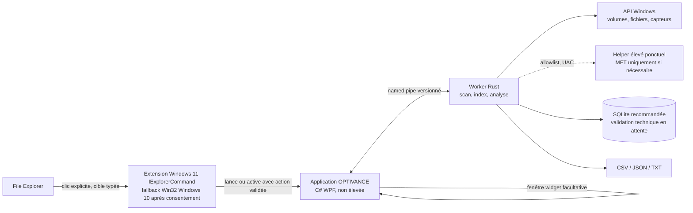

# OPTIVANCE — Architecture proposée après revue de Phase 0

**Date :** 10 novembre 2026, alignée le 11 novembre 2026 sur D-17 et D-18  
**Statut :** proposition documentaire mise à jour après les arbitrages produits du 10 novembre 2026. Aucun code applicatif, service, package ou changement système n’a été créé. Une décision produit ne vaut pas validation technique.

## 1. Objectifs d’architecture

- Garder scanning, index, agrégats, recherche, treemap et doublons indépendants de l’UI.
- Maintenir une faible activité au repos et ne démarrer des opérations qu’après une action explicite.
- Séparer l’application normale des opérations réellement élevées.
- Permettre l’intégration facultative Windows 11 sans exécuter de scan dans File Explorer.
- Respecter l’absence de télémétrie, cloud, transfert automatique et updater en v1.
- Privilégier des messages typés, bornés, annulables et auditables.

## 2. Forme proposée

Architecture produit de référence approuvée : shell C# WPF sur .NET 10 LTS self-contained x64 + un moteur Rust x64 partagé, SQLite comme solution de stockage locale recommandée en attente de validation technique, helper élevé ponctuel et adaptateur Windows Shell natif distinct. Le runtime .NET est embarqué; l’utilisateur n’installe pas séparément .NET Desktop Runtime 10. L’installation est classique et per-user dans le profil, sans droits administrateur obligatoires; les tâches qui nécessitent des privilèges gardent leur UAC ponctuelle. Windows 11 utilise `IExplorerCommand`; Windows 10 Enterprise LTSC 2019 utilise un verbe du menu classique, les deux facultatifs avec consentement. Un échec de l’intégration Shell ne limite pas l’usage de l’interface principale. La politique de compatibilité Windows demeure celle de D-01. L’architecture approuvée n’est pas une preuve d’implémentation ou de performance.

## 3. Processus et responsabilités

### Application WPF — utilisateur standard

Gère les six destinations (D-17, pas de Dashboard) : Storage (page d’accueil), Cleaning, Monitoring, Optimization, History et Settings, ainsi qu’une barre d’état d’activité globale. Héberge le collecteur de monitoring partagé et la fenêtre widget dans le même processus. Affiche progression, résultats paginés, sélection, détails et erreurs. N’héberge ni l’index complet ni le parsing brut du MFT dans ses modèles visuels. Reste non élevée.

Un treemap personnalisé dessine des lots de rectangles sur une surface; les lignes de l’arbre sont virtualisées. L’UI demande des pages et agrégats au moteur. Navigation clavier, libellés accessibles, respect du contraste Windows et informations non uniquement codées par couleur sont exigés. Les graphes de monitoring consomment un ring buffer borné.

### Worker Rust — processus local à la demande

Démarre lorsqu’une analyse, recherche, export ou opération de nettoyage est demandée. Possède l’index compact et gère :

- découverte des volumes et scan classique cancellable;
- backends NTFS expérimentaux isolés (API d’énumération et parsing brut séparés);
- modèle de fichiers/liens et politiques de taille/hardlink;
- rollups, extensions, grands fichiers, recherche et filtres;
- détection de doublons (taille, hash partiel si utile, hash intégral de confirmation);
- calcul de géométrie treemap et sélection/hit-test;
- recommandations de nettoyage en lecture seule, exports et résultats paginés;
- inventaire informatif des processus/services et opérations manuelles, confirmées et réversibles sur les seules entrées de démarrage prises en charge;
- profiling de concurrence/mémoire, structured errors et diagnostic local.

Ne suit pas automatiquement reparse points/jonctions; ne lit pas les contenus pour un scan normal; ne supprime rien sans ordre dédié, preview et confirmation transmis par une action UI approuvée.

### Helper élevé ponctuel

Composant distinct, lancé après action d’analyse et consentement UAC uniquement quand le backend retenu le demande. Reçoit une commande allowlistée, volume identifié et paramètres validés. Accès brut en lecture seule. N’accepte ni shell arbitraire, ni suppression, changement ACL/propriétaire, écriture/repair FSCTL ou mutation USN. Un refus UAC revient au scan classique et indique la méthode utilisée.

### Adaptateur de menu contextuel facultatif

La voie Windows 11 est choisie au niveau produit : `IExplorerCommand`, DLL COM native et extension `windows.fileExplorerContextMenus`, avec identité de package pour apparaître dans le menu principal. Un sparse package signé, fourni par l’installateur classique, reste la voie technique proposée. Sur Windows 10 Enterprise LTSC 2019, proposer un verbe Win32 per-user pour le menu classique. Aucune inscription n’est faite sans consentement explicite; un refus ne change rien. L’échec ou l’indisponibilité de toute intégration Shell laisse l’application principale entièrement utilisable.

Sur Windows 10 Enterprise LTSC 2019, le menu utilise un verbe Win32 per-user classique. Le support de ce menu n’est pas promis pour LTSC 2021. En cas d’échec ou d’indisponibilité, afficher une erreur compréhensible et conserver l’application utilisable depuis son interface principale. Les commandes ne s’appliquent qu’aux dossiers et volumes reconnus; masquer celles qui ne s’appliquent pas. « Analyser avec OPTIVANCE » ouvre Storage et demande confirmation avant le scan. Les autres actions sont : ouvrir OPTIVANCE; analyser directement un dossier; analyser directement un volume/disque reconnu; ouvrir Cleaning et lancer uniquement la pré-analyse. Aucun scan, suppression ou I/O prolongé dans Explorer; `Invoke` valide la cible et transmet une enum et des arguments validés à l’application, même fermée. Toute commande de nettoyage est non destructive.

Les callbacks de construction du menu restent très rapides. La désactivation depuis Settings et le désinstallateur retirent uniquement les inscriptions OPTIVANCE; aucun redémarrage d’Explorer en silence. La signature, le Publisher, l’enregistrement de l’identité, le comportement upgrade/uninstall et le fallback sont à prototyper. Les références Microsoft décrivent `IExplorerCommand` et l’identité de package pour le menu Windows 11 ([extension](https://learn.microsoft.com/en-us/windows/apps/desktop/modernize/integrate-packaged-app-with-file-explorer)), les limites entre OS ([MSIX Windows 10/11](https://learn.microsoft.com/en-us/windows/apps/package-and-deploy/msix-windows10-windows11)) et les verbes Win32 classiques ([Shell verbs](https://learn.microsoft.com/en-us/windows/win32/shell/fa-verbs)).

### Fenêtre widget flottante

Décision : petite fenêtre WPF, dans le même processus que l’application, et un seul collecteur partagé avec la page Monitoring, sans service Windows ni second collecteur. À la fermeture de la fenêtre, le comportement par défaut est la fermeture complète : arrêter application, widget, moteur, jobs, collecteurs et monitoring; aucun processus OPTIVANCE invisible ne subsiste. Settings permet aussi (2) le maintien dans la zone de notification avec fonctionnement en arrière-plan ou (3) le maintien du seul widget avec les métriques nécessaires. Le menu tray comprend `Open OPTIVANCE`, `Show/Hide Widget`, `Settings` et `Quit OPTIVANCE`; Quit force la fermeture complète.

Widget, démarrage avec Windows et Always-on-top sont désactivés par défaut. Les autres préférences locales comprennent la visibilité de l’icône tray et l’arrêt de la surveillance lorsque le widget est masqué. Aucun échantillonnage sans consommateur actif, sauf option explicite de fonctionnement en arrière-plan. Aucun service permanent. Les budgets CPU/RAM et détails de transition sont à valider.

## 4. Contrat de communication

Windows Named Pipe local, ACLé pour l’utilisateur courant, avec protocole versionné, messages bornés, versions/tailles/commandes validées et allowlist. Un seul worker Rust sert l’application principale et la fenêtre widget; aucun serveur réseau. Événements : démarré, progrès, résultats progressifs bornés, erreur structurée, achevé, interrompu/annulé. Un plantage Rust ne ferme pas l’interface : l’UI reste ouverte et présente une erreur compréhensible.

Chaque requête possède un ID de corrélation; chaque flux a un numéro de séquence monotone. Limites de longueur/nombre d’items, schéma strict, temporisations, validation des chemins et rejet des versions incompatibles. Aucun message ne permet d’exécuter du code, un shell ou une action qui ne figure pas dans l’allowlist.

## 5. Modèle de données et stockage

- Identité de fichier : volume + référence NTFS + numéro de séquence; chemin traité comme nom d’affichage mutable.
- Enregistrer les chemins/noms de hardlinks séparément d’une identité physique unique; tous les chemins restent visibles et affichent leur taille logique. Un chemin représentatif déterminé de façon stable porte le poids dans les agrégats de répertoires et la treemap; les autres sont des alias sans contribution secondaire. Convention recommandée : volume + file reference number + sequence number pour l’identité; racine canonique et séparateurs normalisés, puis chemin absolu minimal par comparaison ordinale insensible à la casse, départagée par comparaison ordinale sensible à la casse. Vérifier indépendance de l’ordre de scan. Taille logique affichée par défaut; taille allouée secondaire.
- Alternate Data Streams NTFS exclus des totaux ordinaires; les présenter séparément comme métadonnées seulement si leur lecture est fiable.
- Métadonnées par scan : méthode, profil, heures, volume, état (Terminé/Interrompu/Échec), complétude, erreurs, politique de taille et résultat.
- L’historique résumé conserve l’état et les erreurs des scans terminés, interrompus et échoués. Les chemins partiels restent consultables pendant la session et ne sont persistés que si l’inventaire détaillé est activé, dans la limite de sa rétention. Seuls les scans terminés alimentent les statistiques définitives; aucun incomplet n’est présenté comme complet.
- SQLite est la solution locale de référence recommandée pour préférences, résumés, historique de nettoyage/actions et réglages, sous réserve de validation technique. Résumés : rétention 365 jours par défaut; inventaires détaillés uniquement sur demande, 30 jours par défaut. Les durées sont modifiables; la conservation des détails peut être désactivée.
- Migrations, transactions, rétention, recovery, ACL locale; chemins personnels minimisés dans les logs.
- Exports streamés CSV/JSON/TXT avec schéma versionné et sélection explicitée.

## 6. Monitoring et performances

Un seul collecteur, hébergé dans le processus WPF, dessert la page Monitoring et le widget; le moteur Rust n’est pas démarré pour le seul monitoring. Collecter uniquement lorsqu’un consommateur le demande, intervalle faible/configurable. Capteurs CPU, RAM, disques, GPU, températures, fréquences, consommation électrique et réseau (D-18) : API Windows documentées, puis bibliothèques constructeur déjà présentes avec le pilote, chargées dynamiquement après revue de licence; aucun pilote installé, aucune élévation (le helper reste réservé au MFT); une mesure absente est « indisponible ». Historique de performances en mémoire bornée uniquement; graphes dessinés en WPF par défaut.

Les trois profils obligatoires ECONOMY, BALANCED et MAXIMUM PERFORMANCE bornent priorité, concurrence, bloc, cache et rafraîchissement; BALANCED est le défaut recommandé. Le scheduler adaptatif est conditionnel et non garanti en V1 : l’intégrer seulement si les benchmarks démontrent un bénéfice réel, une fiabilité suffisante et l’absence de régression significative; sinon conserver les réglages fixes, prévisibles et bornés. Aucune promesse de speedup sans benchmark reproductible sur HDD, SATA SSD et NVMe.

## 7. Nettoyage et optimisation

Le nettoyage sépare analyse, sélection et exécution. Les règles expliquent fichier/catégorie, taille et risque. Corbeille par défaut; suppression définitive séparée. Historique conserve le résultat. Le menu Explorer « Nettoyer avec OPTIVANCE » appelle exclusivement l’analyse préalable.

La désinstallation avancée de logiciels tiers (alternative envisagée à Revo Uninstaller) est réservée à une version ultérieure, hors V1. Elle ne fait pas partie des modules livrés dans cette architecture V1; aucun résidu n’est supprimé automatiquement et aucune clé de registre n’est nettoyée automatiquement.

Optimization : processus et services strictement informatifs/en lecture seule. Les entrées de démarrage prises en charge peuvent être activées ou désactivées manuellement après confirmation explicite et sauvegarde de l’état initial; proposer une restauration lorsque techniquement possible. Aucune modification automatique, aucun arrêt silencieux de processus/service, aucune modification d’ACL, de propriétaire ou de permissions système.

## 8. Compatibilité, installation et mises à jour

La politique v1 est précise : Windows 11 x64 maintenu est la cible principale; Windows 10 Enterprise LTSC 2019 x64 (1809) est la cible secondaire de référence; Enterprise LTSC 2021 x64 (21H2) est compatible uniquement tant que l’installation reçoit effectivement un support de sécurité applicable. Une simple éligibilité à un ESU ne suffit pas. IoT Enterprise LTSC est exclu du support général v1 jusqu’à validation technique et décision séparées. Windows 10 Home/Pro, Enterprise non-LTSC et LTSB 2016 sont hors périmètre v1. La matrice .NET 10 x64 indique les lignes 21H2, 1809 et 1607 sous LTSC/Enterprise, mais cette admissibilité du runtime ne modifie pas les limites produit ci-dessus. Revalider la matrice .NET et le support actif de Windows 11 à chaque release ([matrice .NET](https://learn.microsoft.com/en-us/dotnet/core/install/windows), [cycle .NET](https://learn.microsoft.com/en-us/dotnet/core/releases-and-support), [cycle Windows 10](https://learn.microsoft.com/en-us/windows/release-health/release-information)).

Le runtime est .NET 10 LTS self-contained x64 avec WPF : .NET Desktop Runtime 10 est embarqué et n’est pas une installation requise séparément. Les obligations de redistribution et notices du pack runtime exact doivent être vérifiées avant distribution. L’installateur classique est per-user dans le profil, sans droits admin. Le sparse package signé est un auxiliaire possible pour l’identité/menu Windows 11; toolset, signature et détails de publication restent à valider. V1 : installateur signé et notes de version distribués manuellement; aucune vérification automatique ni notification de nouvelle version. Désinstallation standard : retirer application, raccourcis/intégrations OPTIVANCE et conserver paramètres/historique. Désinstallation complète : retirer aussi paramètres, historique, caches et données OPTIVANCE après confirmation explicite. Aucune dépendance dev Python/Rust n’est requise sur le poste utilisateur.

## 9. Sécurité, erreurs et vie privée

- Aucun scan automatique ou réseau; aucune télémétrie, cloud, auto-update ou upload.
- Aucun accès admin global; opérations coûteuses et toute élévation sont explicites.
- Reparse points sans suivi par défaut; chemins normalisés, `..` non admis depuis l’IPC, courses et disparitions prises en charge.
- Parsing MFT : arithmétique vérifiée, offsets/bornes/tailles vérifiés, allocations bornées, erreur recoverable plutôt que panic.
- Logs locaux configurables, minimisation/masquage des chemins; aucun chemin personnel ne doit entrer dans l’extension Shell ou les rapports sans nécessité.
- Erreur structurée : ID, étape, code natif, item/volume, réessayabilité et texte sûr.
- Un fichier inaccessible ne met pas fin à tout le scan; résultat partiel clairement indiqué. Les trois états de scan ne doivent jamais être fusionnés : seuls les résultats complets entrent dans les statistiques définitives.

## 10. Responsabilités modulaires

`scanner-walk`, `scanner-ntfs`, `index/model`, `analysis`, `treemap`, `duplicates`, `cleanup-analysis`, `cleanup-execution`, `optimization-inventory`, `startup-entry-actions`, `monitoring`, `storage/history`, `export`, `platform/windows`, `engine-protocol`, `admin-helper`, `shell-context-adapter`, `ui/pages`, `ui/widget`, `installer/package` et `docs`. Ces responsabilités ne justifient pas la création de dossiers vides; les modules sont ajoutés quand une phase les implémente.

## 11. Risques à traiter

1. Parité et robustesse de lecture MFT sur volume évolutif/corrompu, avec UAC ponctuelle uniquement si le scan MFT demandé la nécessite.
2. Exactitude de la déduplication hardlink dans les agrégats et compatibilité streams/tailles sparse/compressées.
3. DLL/COM du menu principal, signatures, identité package et nettoyage enable/disable/uninstall.
4. Taille de l’index et treemap d’un dossier à millions d’entrées.
5. Helper élevé et authentification du pipe local.
6. Mesures capteurs absentes ou non comparables.
7. Exécution d’actions de nettoyage ou optimization avec dommages.
8. Coût de packaging multi-langage et support OS.

## 12. État des décisions

Décisions produit approuvées : politique Windows v1; .NET 10 self-contained x64; WPF + Rust via Named Pipes versionnés et moteur partagé; limites MFT/UAC; hardlinks avec représentant déterministe et ADS hors totaux; états/rétentions; cycle de vie et valeurs par défaut; optimisation Windows limitée; trois profils obligatoires et scheduler adaptatif conditionnel; menu W11/LTSC 2019 avec consentement; installation per-user, mises à jour manuelles et deux modes de désinstallation; désinstalleur tiers reporté. SQLite est la solution technique de référence recommandée, en attente de validation technique. Restent à valider : backend MFT, toolset/signature/sparse package, détails Shell, lecture fiable des ADS, budgets/valeurs, compatibilité, restauration et transitions/erreurs. Aucun arbitrage approuvé ne constitue une preuve d’implémentation. Voir [ARCHITECTURE_DECISIONS.md](ARCHITECTURE_DECISIONS.md) et [ARCHITECTURE_VALIDATION_PLAN.md](ARCHITECTURE_VALIDATION_PLAN.md). Cette proposition ne déclenche pas la Phase 1.
