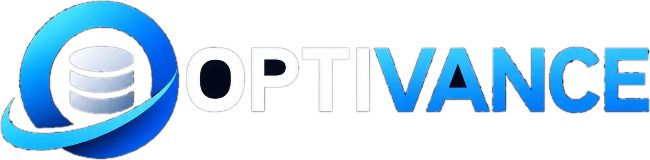
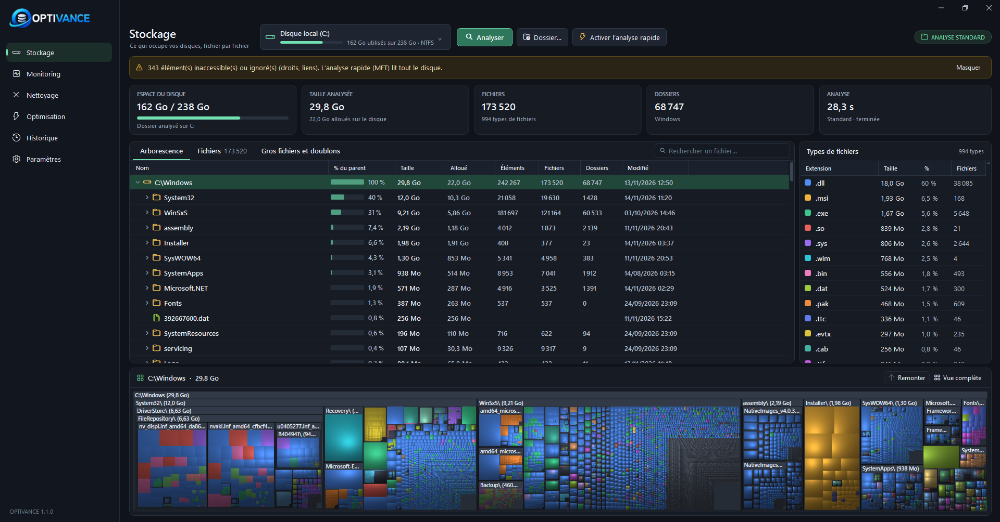
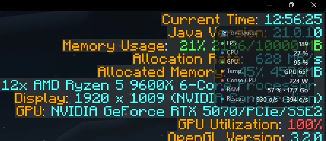
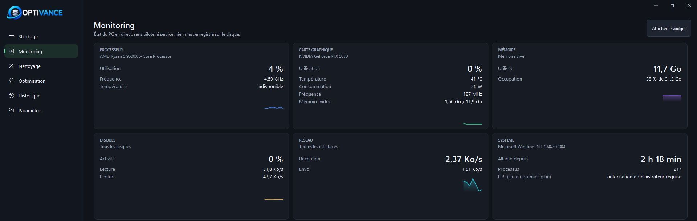
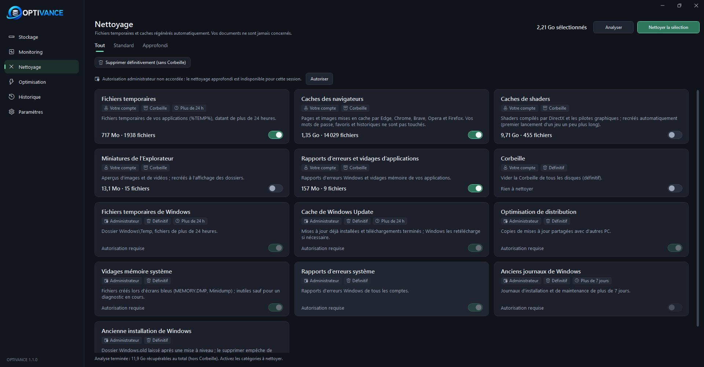
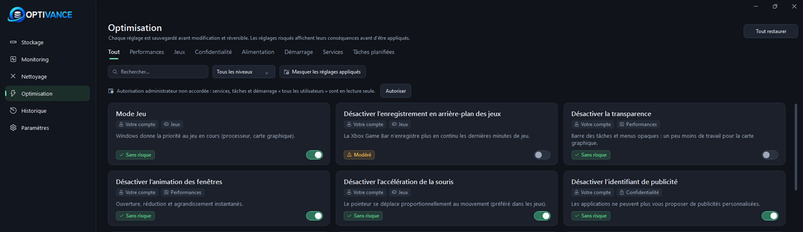

<p align="center">
  
</p>

<h3 align="center">Votre PC, plus rapide, plus propre, sous contrôle.</h3>

<p align="center">
  Stockage · Monitoring · Widget FPS en jeu · Nettoyage · Optimisation<br>
  <b>100 % local</b> — aucun compte, aucune télémétrie, vos données restent sur votre PC.
</p>

<p align="center">
  <a href="https://github.com/CocaB1Frais/optivance/releases/latest/download/OPTIVANCE.exe"></a>
</p>

<p align="center">
  <a href="https://github.com/CocaB1Frais/optivance/releases/latest"></a>
  
  
</p>

---

## Un seul fichier, rien à installer

Téléchargez **`OPTIVANCE.exe`**, double-cliquez : c'est tout. Pas d'installateur, pas de .NET à installer, pas de compte.
Le fichier se range où vous voulez (Bureau, Documents, clé USB).

> Premier lancement : Windows peut afficher « Windows a protégé votre ordinateur » (application non signée).
> Cliquez sur **Informations complémentaires** puis **Exécuter quand même**.

---

## Ce que fait OPTIVANCE

### 💾 Stockage — voir ce qui remplit vos disques
Analyse d'un disque entier en quelques secondes grâce à la lecture directe de la table NTFS (comme WizTree), arborescence, carte visuelle interactive, types de fichiers, **gros fichiers et doublons** (vérifiés par leur contenu). Suppression vers la Corbeille, avec confirmation.
Accessible aussi par **clic droit sur le Bureau › OPTIVANCE** (désactivable dans Paramètres).

<p align="center"></p>

### 📊 Monitoring et widget FPS
Processeur, carte graphique (NVIDIA et AMD), mémoire, disques, réseau et températures, sans pilote.
Le **widget transparent apparaît tout seul en jeu** et affiche les **FPS de tous les jeux** (DirectX, OpenGL, Vulkan — Minecraft compris), sans rien injecter dans le jeu : **aucun risque avec les anti-triche**.

<p align="center"></p>

<p align="center"></p>

### 🧹 Nettoyage — récupérer des gigaoctets sans risque
Fichiers temporaires, caches des navigateurs et des jeux, rapports d'erreurs, et nettoyage approfondi des emplacements Windows (mises à jour, Windows.old…). Aperçu de l'espace récupérable, Corbeille par défaut, vos documents ne sont jamais concernés.

<p align="center"></p>

### ⚡ Optimisation — avec des garde-fous
Mode Jeu, alimentation, applications au démarrage, effets visuels, services et tâches de télémétrie. Chaque réglage indique son **niveau de risque** et ses conséquences, est **sauvegardé avant modification** et **réversible** en un clic (« Tout restaurer »).

<p align="center"></p>

### 🕑 Historique
Toutes les actions réalisées (suppressions, nettoyages, réglages), conservées sur votre PC.

---

## Vos données restent chez vous

- Aucun compte, aucune télémétrie, aucun service installé en permanence, aucun pilote. Seule connexion : vérifier une fois par jour s'il existe une nouvelle version sur GitHub (désactivable).
- Paramètres et historique : `%LOCALAPPDATA%\OPTIVANCE`, sur votre PC uniquement.
- L'autorisation administrateur demandée au lancement (une fois par session) sert à l'analyse rapide des disques, au nettoyage approfondi, aux réglages système et aux FPS. Refusée : OPTIVANCE fonctionne en mode standard.

## Questions fréquentes

<details><summary><b>Est-ce que ça marche avec ma carte AMD ?</b></summary>

Oui : utilisation, température, consommation et fréquence via la bibliothèque installée avec le pilote AMD. NVIDIA est lue de la même façon.
</details>

<details><summary><b>Le widget ne s'affiche pas sur mon jeu</b></summary>

En « plein écran exclusif », Windows n'affiche aucune fenêtre par-dessus le jeu. Choisissez **plein écran fenêtré** ou **sans bordure** dans les options d'affichage du jeu (OPTIVANCE vous le rappelle par une notification). Raccourci manuel : **Ctrl+Alt+W**.
</details>

<details><summary><b>Est-ce que je risque un ban ?</b></summary>

Non : OPTIVANCE n'injecte rien dans les jeux. Les FPS sont lus dans les événements publiés par Windows, comme l'outil PresentMon.
</details>

<details><summary><b>Ça consomme beaucoup ?</b></summary>

Au repos, environ 0,1 à 0,3 % du processeur ; la mesure des FPS elle-même est inférieure à 0,01 %.
</details>

## Mise à jour et désinstallation

- **Mise à jour** : automatique. OPTIVANCE vous prévient quand une nouvelle version sort ; un clic suffit pour l'installer et redémarrer (Paramètres › À propos › Rechercher, à tout moment). Paramètres et historique sont conservés.
- **Désinstallation** : **Paramètres › Désinstallation**. OPTIVANCE restaure les réglages Windows qu'il a modifiés, retire ses intégrations, puis supprime l'application et ses données. Vos autres fichiers ne sont jamais touchés.

**Configuration requise** : Windows 10 (1809+) ou Windows 11, 64 bits.

---

<details><summary><b>Développement</b></summary>

| Dossier | Contenu |
|---|---|
| `source/Optivance.Desktop` | Interface WPF (.NET 10) |
| `source/Optivance.Core` | Logique pure (tests automatiques) |
| `source/Optivance.Infrastructure` | Accès Windows, capteurs, moteur intégré |
| `source/engine` | Moteur Rust : analyse, lecture MFT, composant administrateur, FPS (ETW) |
| `source/tests` | Tests automatiques |
| `source/tools/ScanProbe` | Outil de mesure et de diagnostic |
| `docs/` | Architecture, décisions, gouvernance, rapports de validation |

Prérequis : SDK .NET 10, Rust (rustup, cible `x86_64-pc-windows-msvc`).

```powershell
.\build.ps1            # tests puis OPTIVANCE.exe à la racine
.\build.ps1 -Clean     # idem, puis supprime les fichiers de compilation
```

**Publier une version** : modifier `<Version>` dans `Directory.Build.props` et `CHANGELOG.md`, puis `git tag vX.Y.Z` et `git push --follow-tags`. GitHub construit, publie `OPTIVANCE.exe` dans Releases et le place à la racine du dépôt.
</details>

## Licence

© 2026 OPTIVANCE. Tous droits réservés — voir [LICENSE](LICENSE). Composants tiers : [THIRD_PARTY_LICENSES.md](THIRD_PARTY_LICENSES.md).
